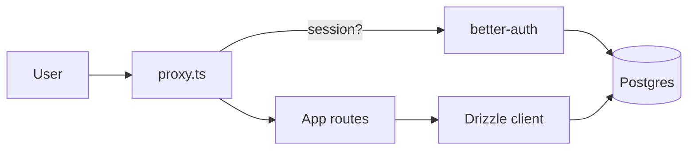

# AGENTS.md

Guidance for AI coding agents (Droid, Claude Code, Cursor, etc.) working in the
`freedom-four` repository. Human contributors should read `README.md`; this file
exists to give agents the rules, architecture, and verification steps they need
to make safe, consistent changes.

---

## 1. Project overview

`freedom-four` is a personal instrument for measuring and reflecting on four
dimensions of freedom: **Financial, Location, Time, Health**. It pairs a daily
check-in with a weekly review so the user can compound progress over time.
Working name, private beta, single-tenant-per-household data model.

---

## 2. Tech stack

| Layer            | Choice                                                                   |
| ---------------- | ------------------------------------------------------------------------ |
| Framework        | Next.js 16 (App Router, Turbopack), React 19                             |
| Language         | TypeScript (strict)                                                      |
| UI               | Tailwind CSS v4 + custom editorial theme (serif display, ink/paper)      |
| Database (prod)  | **PostgreSQL 18.3 on PlanetScale Postgres**                              |
| Database (local) | Postgres 17 via `docker/compose.dev.yml`                                 |
| ORM              | Drizzle ORM `^0.45` + drizzle-kit `^0.31` (dialect: `postgresql`)        |
| DB driver        | `postgres.js` (`postgres` package), cached on `globalThis`, `max: 1`     |
| Auth             | `better-auth` `^1.2` — magic link, DB-backed sessions                    |
| Email            | Resend (dev falls back to console log when `RESEND_API_KEY` is empty)    |
| Validation / env | Zod + `@t3-oss/env-nextjs`                                               |
| Package manager  | **pnpm 9** (required — see agent rules)                                  |
| Node             | 22 (see `.nvmrc`)                                                        |
| Tooling          | ESLint, Prettier, Husky + lint-staged, commitlint (conventional commits) |

---

## 3. Commands

All commands use `pnpm`. Never substitute `npm` or `yarn` (see §8).

| Command             | When to use                                              |
| ------------------- | -------------------------------------------------------- |
| `pnpm dev`          | Start Next.js dev server (Turbopack)                     |
| `pnpm dev:host`     | Dev server bound to `0.0.0.0` for LAN testing            |
| `pnpm build`        | Production build — run before declaring a feature done   |
| `pnpm start`        | Serve the production build                               |
| `pnpm lint`         | ESLint — **must pass before finishing any task**         |
| `pnpm lint:fix`     | ESLint with autofix                                      |
| `pnpm format`       | Prettier write                                           |
| `pnpm format:check` | Prettier check (CI-style)                                |
| `pnpm typecheck`    | `tsc --noEmit` — **must pass before finishing any task** |
| `pnpm db:up`        | Start local Postgres (Docker)                            |
| `pnpm db:down`      | Stop local Postgres                                      |
| `pnpm db:logs`      | Follow Postgres logs                                     |
| `pnpm db:generate`  | Generate migration SQL from the schema diff              |
| `pnpm db:migrate`   | Apply pending migrations (use for PlanetScale and CI)    |
| `pnpm db:push`      | **Local dev only.** Never run against PlanetScale.       |
| `pnpm db:studio`    | Open Drizzle Studio                                      |
| `pnpm tunnel`       | Public Cloudflare quick tunnel to `localhost:3000`       |
| `pnpm share`        | Run `dev` + `tunnel` concurrently                        |

**Always-run before handing work back:** `pnpm typecheck && pnpm lint`. For
anything touching routes, components, or config, also run `pnpm build`.

---

## 4. Architecture

Repository layout (trimmed):

```
app/
  (marketing)              public landing
  (auth)/login             magic-link sign-in
  (app)/                   protected group: dashboard, check-in, review, settings
  api/auth/[...all]        better-auth catch-all route handler
components/                UI primitives and freedom widgets
lib/
  auth.ts                  better-auth server config
  auth-client.ts           better-auth browser client
  auth-server.ts           getSession / requireUser helpers
  db/
    client.ts              Drizzle client (postgres.js, cached pool)
    schema.ts              Drizzle schema (auth + app tables)
  env.ts                   Zod-validated env (via @t3-oss/env-nextjs)
  email.ts                 Resend wrapper with dev fallback
  freedoms/                Per-freedom modules (shared interface)
drizzle/                   Generated SQL migrations (commit these)
docker/compose.dev.yml     Local Postgres
proxy.ts                   Next 16 proxy — gates protected routes
```

Request path:



Key rules:

- `proxy.ts` is the authoritative session gate. Don't replicate that check in
  client components or bypass it.
- Data access happens in server components, server actions, or `lib/**`.
  Never import the Drizzle client into a `"use client"` module.
- The Drizzle client is a singleton cached on `globalThis` — do not `new` one
  per request.

---

## 5. Data model

Source of truth: `lib/db/schema.ts`. Migrations live in `drizzle/` as
committed SQL files (plus `drizzle/meta/` journal). Conventions:

- snake_case columns, camelCase TS fields
- `id` is `text` (better-auth uses string ids)
- every tenant-scoped table carries `household_id` plus a `(household_id, …)`
  index
- per-freedom payloads stay loose in `jsonb` until they graduate to typed
  tables

Tables today:

- **Auth:** `users`, `sessions`, `accounts`, `verifications`
- **Tenancy:** `households`, `memberships` (enum: `household_role`)
- **Freedoms:** `freedom_settings`, `entries`, `goals`, `weekly_reviews`
- **Enums:** `freedom`, `entry_source`, `goal_period`, `goal_status`

---

## 6. Environment variables

Minimum required (see `.env.example` for the full list):

| Var                    | Purpose                                            |
| ---------------------- | -------------------------------------------------- |
| `DATABASE_URL`         | Postgres connection (local Docker or PlanetScale)  |
| `BETTER_AUTH_SECRET`   | 32+ byte random secret (`openssl rand -base64 48`) |
| `NEXT_PUBLIC_SITE_URL` | Used to build magic-link callbacks                 |
| `RESEND_API_KEY`       | Optional; dev logs to stdout when empty            |
| `EMAIL_FROM`           | `"freedom-four <noreply@…>"` format                |

Never log `DATABASE_URL`, `BETTER_AUTH_SECRET`, or `RESEND_API_KEY` values.
Only the `NEXT_PUBLIC_*` variables are safe to surface to the client.

---

## 7. Coding conventions

- TypeScript strict — no `any`; prefer `type` aliases for object shapes and
  reuse Drizzle's `$inferSelect` / `$inferInsert` types.
- File / folder naming: kebab-case for files, PascalCase for React components.
- Server components by default. Add `"use client"` only when you need
  interactivity or browser APIs.
- Drizzle queries live in `lib/**` (or colocated server actions). Never in a
  client component.
- Tailwind v4 tokens from the editorial theme. Avoid ad-hoc hex values.
- Match the style of surrounding files — indentation, import order, comment
  tone, and component shape.
- Conventional Commits (enforced by commitlint). Examples:
  `feat: add weekly review chart`, `fix(auth): expire stale sessions`.

---

## 8. Agent rules (MUST follow)

1. **pnpm only.** Never run `npm install`, `npm run …`, `yarn`, or `bun`. If
   dependencies feel out of sync, run `pnpm install --frozen-lockfile`.
2. **No secrets in commits.** Before any `git commit` (or `git push`):
   - Run `git status` and `git diff --cached`.
   - Scan for `.env*` files other than `.env.example`, connection strings
     (`postgres://…`), `BETTER_AUTH_SECRET`, `RESEND_API_KEY`, bearer tokens,
     or other credentials.
   - If anything looks sensitive, stop and surface it to the user.
3. **Never `pnpm db:push` against a non-local database.** PlanetScale and any
   Vercel environment use the migrate flow only.
4. **Schema change workflow:**
   1. Edit `lib/db/schema.ts`.
   2. `pnpm db:generate` to emit SQL into `drizzle/`.
   3. Review the generated SQL — don't hand-edit it, regenerate if wrong.
   4. Commit schema + generated SQL together.
   5. Apply with `pnpm db:migrate` (local) or `DATABASE_URL="<planetscale>" pnpm drizzle-kit migrate` (prod/preview).
5. **Connection pooling.** `postgres()` stays at `max: 1` in server runtimes.
   PlanetScale pools at the edge; raising `max` blows through connection
   budgets on Vercel cold starts.
6. **Git safety.** Never `git push` — and never `--force` anything — without
   explicit user instruction. Never push directly to `main`. Don't modify
   `git config`.
7. **Done-means-green.** Before reporting a task complete, run
   `pnpm typecheck` and `pnpm lint`. For feature work, also run `pnpm build`.
   Do not mark work complete while any of these fail.
8. **No lint ignores. Ever.** This project lints the whole repository. Do
   NOT add any of the following under any circumstance:
   - a global `ignores` block in `eslint.config.mjs`
   - an `ignorePatterns` entry
   - an `.eslintignore` file
   - any `eslint-disable`, `eslint-disable-next-line`, or
     `eslint-disable-line` directive in source files
   - a `// @ts-ignore` / `// @ts-expect-error` to dodge a lint rule

   If a file triggers a rule, fix the code. If a rule fundamentally
   conflicts with a framework contract (e.g. Next.js App Router reserved
   filenames, better-auth's destructured client), add a narrowly-scoped
   per-file-pattern rule override in `eslint.config.mjs` with a comment
   explaining the framework constraint. Overrides must name specific files
   and specific rules — never disable a rule globally and never use them as
   a convenience escape hatch.

---

## 9. PlanetScale-specific notes

- Prod database is **PostgreSQL 18.3 on PlanetScale Postgres** (a managed
  Postgres offering — not PlanetScale's legacy MySQL product).
- PlanetScale gives you a Postgres connection string per branch (grab it
  from the branch's **Connect** tab in the dashboard). `sslmode=require`
  is mandatory — don't strip it.
- Local Docker is Postgres 17; production is 18.3. Avoid features that don't
  exist in 17 if you want dev/prod parity, or bump the Docker image.
- Apply migrations from your machine with:

  ```bash
  DATABASE_URL="<planetscale connection string>" pnpm drizzle-kit migrate
  ```

- Preview / dev branches on PlanetScale get their own connection strings.
  Wire those into Vercel's Preview environment only.

---

## 10. Gotchas

- `proxy.ts` (Next 16 proxy) is the session gate. Don't replicate auth checks
  on the client, and don't add routes that bypass it without updating its
  matcher.
- better-auth's catch-all handler lives at `app/api/auth/[...all]`. Don't add
  sibling `app/api/auth/*` routes — they'll be shadowed.
- The Drizzle client in `lib/db/client.ts` is cached on `globalThis`. Import
  from there; don't instantiate your own.
- `drizzle/**` is ignored by ESLint and is generated. Don't hand-edit the SQL;
  regenerate via `pnpm db:generate`.
- Husky + lint-staged run Prettier and ESLint on staged files. commitlint
  enforces Conventional Commits on the message. If a pre-commit hook rewrites
  files, stage them and amend.
- `RESEND_API_KEY` unset in dev is expected — magic links print to the server
  console; click the printed URL to sign in.

---

## 11. When stuck

Sources of truth, in priority order:

1. `README.md` — human-facing setup, deploy recipe, roadmap.
2. `lib/db/schema.ts` + `drizzle/meta/` — current data model and migration
   history.
3. `lib/auth.ts`, `lib/auth-server.ts`, `proxy.ts` — auth + session behavior.
4. `lib/env.ts` + `.env.example` — environment contract.
5. `lib/freedoms/` — per-freedom modules and their shared interface.

If a decision isn't covered here or in those files, ask the user before
inventing one.
